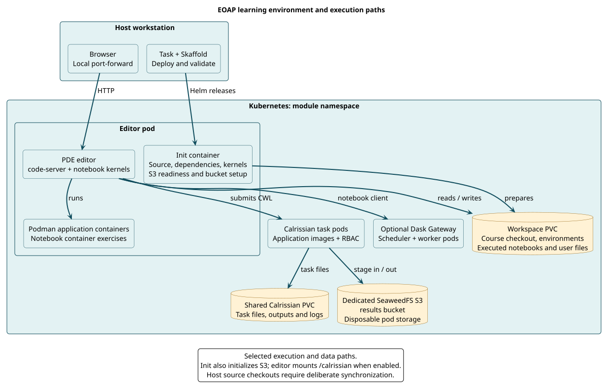

# Architecture and execution layers

The platform puts an EOAP learning workspace beside the Kubernetes services its exercises need. This lets a learner explore code and notebooks in the same environment a module developer uses for acceptance.

The course and platform are separate repositories. The course contains applications, CWL, notebooks and its own documentation/tests. The platform contains a Helm editor chart and per-course initialization, service configuration and task wrappers. This separation allows a course to define its learning content while the platform provides a repeatable execution setting.

The [C4 architecture model](c4/README.md) complements this execution view with documented system context, container, component and code levels. Use it to understand the platform's boundaries and then zoom into the learning workspace and notebook runner.

## From host command to exercise output

[PlantUML source](../diagrams/src/platform-architecture.puml)

Task orchestrates commands on the host. Skaffold installs the Helm releases and can watch configuration while forwarding the editor service. Kubernetes schedules an init container before the editor starts. Initialization obtains the training source, prepares environments and configures the module's S3 access.

The editor mounts a persistent workspace and opens the course directory. Notebook kernels use the environment registered for that course. Source files edited on the host are a separate copy until synchronized into that PVC.

## Three execution environments

A notebook may run Python directly in its kernel. Another cell may build/run an application with Podman inside the editor container. A Calrissian workflow creates Kubernetes task pods that execute application images with shared storage and service-account permissions. These are different boundaries; a working kernel does not prove Podman or Kubernetes execution works.

Dask adds a gateway, scheduler and workers. The client and workers must agree on Python serialization and package versions. The notebook path uses a Python 3.12 worker matching PDE, while the bounded Calrissian test selects a published application image. Keeping these paths distinct makes it possible to explain what each result proves.

## PDE and the chart

Migrated modules explicitly select `eoepca/pde-code-server:amd64`. PDE supplies the editor and common tooling, including isolated Calrissian. Module environments still own course-specific dependencies; global PDE packages do not automatically appear in a virtual environment.

The shared chart directly launches code-server, bypassing PDE's normal entrypoint integrations. It currently disables editor authentication and permits a privileged editor for its training container workflow. A local port-forward fits this development configuration. Shared or public access needs explicit authentication and security configuration.

The chart's legacy default and historical image CI remain separate migration work. A migrated module override is an intentional integration decision, not proof that every repository deployment already uses PDE.

## Kubernetes and Minikube

Minikube is the tested local host for Kubernetes, not the definition of an EOAP. Typed CWL contracts, published packages and generic context selection allow targeting other clusters. The target still has to supply suitable images, storage, RBAC, resources and network access. Validation on one Minikube node does not prove multi-node shared-volume behavior.
