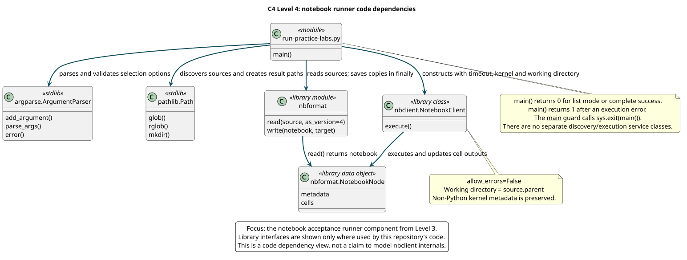

# Level 4: Code

**Question:** Which concrete code interfaces implement notebook selection, execution and evidence retention?

**Boundary:** Expand the **Notebook acceptance runner** component from Level 3, specifically [run-practice-labs.py](../../../mastering-app-package/scripts/run-practice-labs.py). This is a focused module/class dependency view. It does not model the internals of nbclient, code-server or every course application.

[PlantUML source](../../diagrams/src/c4-runner-code.puml)

## Concrete implementation

The runner has a single `main()` function and an `if __name__ == "__main__"` guard that exits with its return value. Discovery, validation, kernel selection and execution are responsibilities inside that function; the diagram does not invent separate service classes for them.

| Interface | Use in the runner | Observable behavior |
| --- | --- | --- |
| `argparse.ArgumentParser` | Declare options, parse arguments, report invalid values | Invalid selection/path/timeout reports an argument error |
| `pathlib.Path` | Resolve notebook root, glob/rglob, exclude checkpoints, create output directories | Source selection remains relative to the configured notebook root and is sorted/deduplicated |
| `nbformat.read` / `write` | Read notebook v4 objects and serialize executed copies | Original teaching notebook remains unchanged; output copy records execution |
| `nbclient.NotebookClient` | Execute using selected kernel, timeout and source-parent working directory | Cell errors fail the run; timeout is per cell |
| `NotebookNode` metadata | Inspect kernel name/language | Python notebooks use the module kernel; non-Python kernel metadata is retained |
| `finally` save path | Write the notebook after success or execution failure | A failed notebook is retained for diagnosis before the runner returns 1 |

## Control flow and exit behavior

Argument validation rejects absolute or parent-traversing notebook selections, missing notebook roots, nonpositive timeouts and empty selections. List mode prints selected paths and returns 0 without importing execution dependencies or running notebooks.

Execution creates a UTC run directory under the requested output root. Before kernels run, `VIRTUAL_ENV_DISABLE_PROMPT=1` prevents virtual-environment activation from changing the fixed prompt expected by Bash kernels. For each selected notebook, the runner determines its kernel and executes with `allow_errors=False` and `resources.metadata.path` pointing to the source notebook's parent.

If execution raises, the runner prints the failure, returns 1 and still writes that notebook in `finally`. Later notebooks do not run. If every selected notebook completes, it returns 0. This means application examples must assert their own subprocess exit values and meaningful outputs; an application that swallows errors can otherwise leave a successful notebook cell.

## Changes that need acceptance review

Changing selection ordering affects prerequisites. Changing kernel mapping affects which environment executes cells. Changing working directories affects relative data/CWL paths. Changing save-on-failure or exit status affects the evidence reported to developers. Test these behaviors deliberately when modifying the runner, and keep this view aligned with the actual function.

The [runner reference](../../reference/tasks-and-runner.md#runner-cli) lists its options. The [validation model](../validation-model.md) explains why execution success and scientific correctness remain separate claims.
