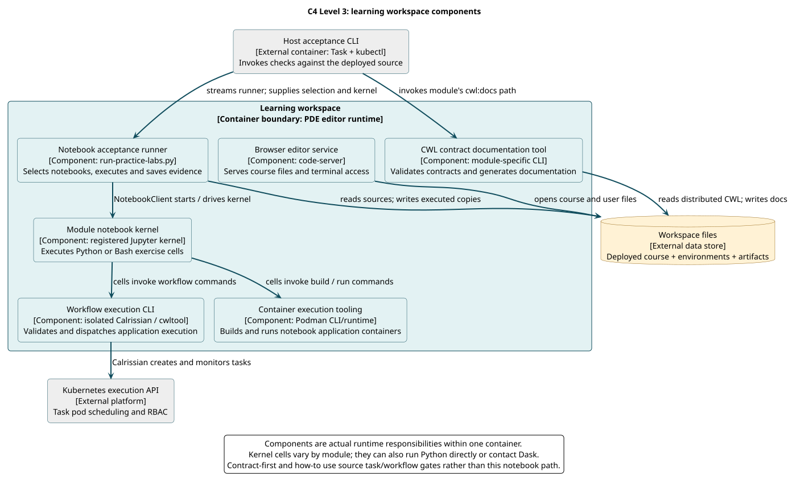

# Level 3: Components

**Question:** How does the learning workspace organize interactive execution and automated acceptance?

**Boundary:** Expand only the **Learning workspace** container from Level 2. The host Task/kubectl interface, workspace data store and Kubernetes API remain outside it. The named components describe real executable responsibilities and are not newly introduced classes or services.

[PlantUML source](../../diagrams/src/c4-components.puml)

## Component responsibilities

| Component | Implementation / provenance | Responsibility |
| --- | --- | --- |
| Browser editor service | Upstream code-server, launched by the chart | Browse/edit deployed course files and expose interactive terminal/notebook integration |
| Notebook acceptance runner | [run-practice-labs.py](../../../mastering-app-package/scripts/run-practice-labs.py) in this repository | Discover a selection, execute it in order and save copies including failures |
| Module notebook kernel | Registered Python or Bash Jupyter kernel | Execute cells with the module's dependencies and working directory |
| CWL contract documentation tool | Training `scripts/cwl-docs.py` or source artifact-derivation tasks | Validate distributed CWL/metadata and generate learner-readable documentation |
| Workflow execution CLI | PDE isolated Calrissian and module cwltool | Validate/dispatch CWL execution; Calrissian interacts with Kubernetes task pods |
| Container execution tooling | PDE Podman CLI/runtime | Build or execute application containers requested by exercise cells |

The runner is streamed into the editor by host task wrappers. It uses `NotebookClient` to drive a kernel against files on the deployed PVC. It does not transfer host training edits or install missing dependencies. Kernel registration is produced during initialization; its interpreter must remain accessible in the editor runtime.

Documentation tooling is module-specific, not a universal platform service. Contract-first runs actual transpiler-mate artifact derivation, whereas several courses use equivalent local renderers. Their common architectural responsibility does not imply identical APIs or validation guarantees.

## Execution variants

A Python cell may run its algorithm directly, invoke cwltool/Calrissian, build/run an application with Podman, or connect to Dask. The diagram highlights the common container/workflow paths without implying every notebook uses them all.

How-to validates real workflow cases instead of invoking the notebook runner. Contract-first uses source reference tasks and quality gates. These differences are why the [task reference](../../reference/tasks-and-runner.md) describes module-specific acceptance rather than assuming a single generic notebook task is sufficient.

## Failure boundaries

A healthy editor service does not establish a working kernel. A passing Python kernel does not establish writable Podman mounts, Kubernetes RBAC or shared task storage. A source generator can complete while producing misleading descriptions; its output needs inspection. Diagnose the component that failed, then rerun affected acceptance against the actual deployed snapshot.

[Level 4](code.md) zooms into the notebook runner's concrete code dependencies. [Troubleshooting](../../how-to/troubleshoot.md) maps these boundaries to operational checks.
