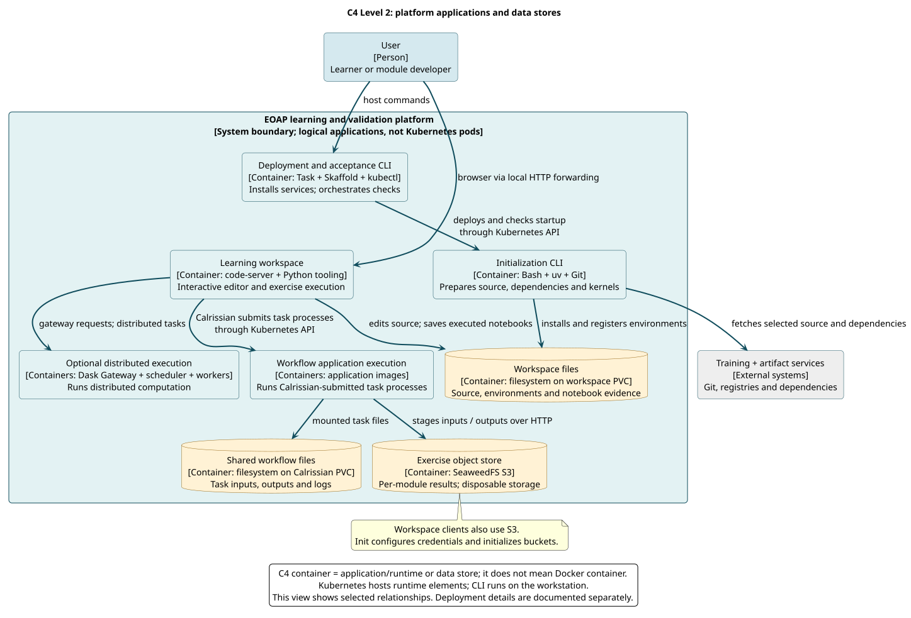

# Level 2: Containers

**Question:** Which runtime applications and data stores implement the platform?

**Boundary:** Expand the platform from Level 1 into its logical applications and stores. “Container” is the C4 term for an application/runtime or data store. A workspace pod contains both initialization and editor execution over time; it is not a one-to-one mapping to a C4 container.

[PlantUML source](../../diagrams/src/c4-containers.puml)

## Runtime and storage responsibilities

| Container | Technology | Responsibility and implementation |
| --- | --- | --- |
| Deployment and acceptance CLI | Task, Skaffold, kubectl on the host | Module Taskfiles deploy Helm releases and invoke checks against a selected context |
| Initialization CLI | Bash, uv and Git in the init container | `files/init.sh` selects source, installs dependencies, registers kernels and prepares S3 configuration/buckets |
| Learning workspace | code-server and Python/tooling in PDE | Opens course files, exposes a terminal and supports notebook/CLI execution |
| Workspace files | Filesystem on `code-server-pvc` | Retains source, environments, notes and executed notebook evidence |
| Workflow application execution | Application image processes in task pods | Executes CWL applications submitted by Calrissian; images belong to the selected course/artifacts |
| Shared workflow files | Filesystem on enabled `calrissian-claim` | Shares task files and retains workflow outputs/logs |
| Exercise object store | Per-module SeaweedFS S3 | Supplies the `results` bucket with disposable pod-local storage |
| Optional distributed execution | Dask Gateway, scheduler and workers | Provisions a cluster and runs distributed tasks for the Dask course |

The Dask element groups cooperating runtime applications to keep this platform-wide view readable. Its workers are separate execution processes/pods, not hidden code components of the editor. A detailed Dask view would expand that group when changing gateway/worker design.

## Interfaces and omitted secondary paths

Task/Skaffold/kubectl use the Kubernetes API to install services and run checks. Learners reach code-server through a local HTTP port-forward. The editor and applications use mounted filesystems for workspace/shared task files and HTTP S3 for stage-in/out.

Initialization also configures S3 and creates required buckets. Workspace clients can inspect and write S3, and the editor mounts `/calrissian` when enabled. Calrissian can invoke Dask-enabled applications. These secondary relationships are documented here instead of drawing every edge over the main execution paths.

The file stores are logical data responsibilities; Kubernetes PVCs and storage classes are their deployment realization. The all-in-one object store currently uses `emptyDir`, so pod replacement has a different persistence effect from replacing the editor pod.

## Map the view to deployment files

[charts/coder/templates/coder.yaml](../../../charts/coder/templates/coder.yaml) defines the init/editor containers, workspace mount and editor service. [The PVC template](../../../charts/coder/templates/pvc.yaml) defines enabled Calrissian storage. Module Skaffold and values files select namespace, image, resources and storage services. See [configuration](../../reference/configuration.md) and [lifecycle](../storage-and-environments.md).

[Level 3](components.md) expands the learning workspace. It does not expand every application-image process; those belong to each training repository's architecture.
