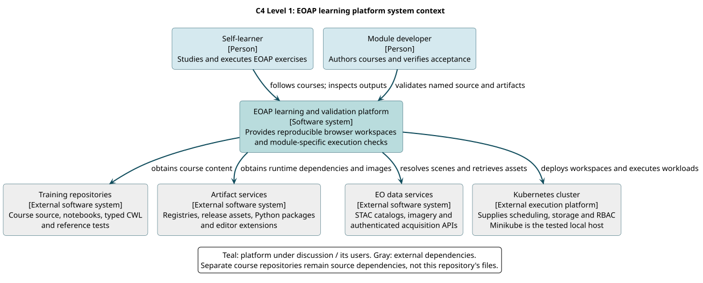

# Level 1: System context

**Question:** Who uses the EOAP learning platform, and which external systems does it rely on?

**Boundary:** Treat this development platform as one software system. Course source, artifact distribution, EO data providers and the Kubernetes execution platform are outside it. The view avoids editor, Python, Helm and pod internals so a learner can first understand the surrounding services.

[PlantUML source](../../diagrams/src/c4-system-context.puml)

## Users and external responsibilities

| Element | Responsibility | Relationship to the platform |
| --- | --- | --- |
| Self-learner | Follow exercises, inspect results and preserve learning notes | Uses a browser workspace and the course's learning sequence |
| Module developer | Author source/contracts and review acceptance | Selects a snapshot, deploys it, runs checks and collects evidence |
| Training repositories | Own notebooks, applications, typed CWL and source quality gates | Supply course content through published refs or explicit local synchronization |
| Artifact services | Distribute images, release assets, Python packages and extensions | Supply executable dependencies; their availability affects initialization and runtime |
| EO data services | Publish STAC catalogs, raster assets and authenticated acquisition APIs | Supply real exercise inputs; failures can block a scientific path |
| Kubernetes cluster | Supply scheduling, permissions and storage | Hosts module services and workflow execution; Minikube is the recorded local setting |

A learner and developer can be the same person, but their goals differ. The learner needs a usable course and understandable outputs. The developer needs reproducible evidence that a named course snapshot works. Separating these roles explains why the repository offers interactive notebooks and automated acceptance tasks.

## Source ownership is an architectural boundary

Adding a platform directory does not create or publish a course. The course's Git history and release process remain separate. A local host edit is not automatically present in the deployed workspace, and a local commit is not a remote branch. The [source guide](../../how-to/work-with-training-source.md) makes this relationship operational.

Artifact and EO-data services are also independent. An editor image can download successfully while its training branch or satellite item is unavailable. Inference's local fixture intentionally bypasses one downloading dependency while retaining real model execution; Dask's EOPF HTTP 500 is an external failure with a recorded acceptance consequence.

## What this level leaves out

This diagram does not show namespaces, PVC access modes, service accounts, worker versions or lifecycle ordering. These details would obscure the system boundary. [Level 2](containers.md) expands the platform into applications and data stores; [configuration reference](../../reference/configuration.md) provides exact names and settings.
