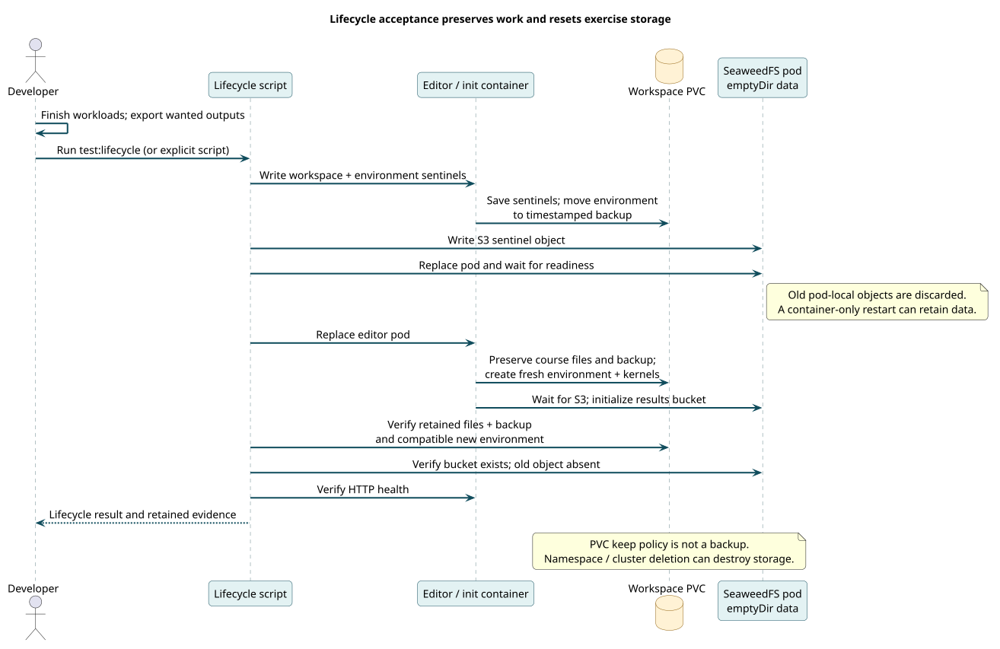

# Persistent workspaces and disposable data

Learning creates two kinds of state with different lifetimes. The workspace contains user edits, notes, cloned Git repositories, environments and executed notebooks. S3 contains generated exercise outputs and staged artifacts. The platform deliberately retains the first while treating the second as disposable.

[PlantUML source](../diagrams/src/storage-lifecycle.puml)

## Why retain the workspace

A learner should be able to restart the editor without losing notebook work. The editor mounts `code-server-pvc`, and Calrissian uses a retained shared claim when enabled. Helm keep annotations support retention across release removal. They do not replace exports/backups and cannot protect against deletion of the underlying cluster or volumes.

Dependency environments also live in the workspace. This speeds repeated sessions but can preserve incompatibilities when the base image, Python installation or architecture changes. Initialization that allows an existing environment does not itself prove a fresh install is reproducible.

The lifecycle test moves the old environment aside rather than deleting the workspace. A new init pass builds a compatible environment while keeping the old one for inspection. Mastering's Hatch kernels add another layer: kernel files must point at interpreters on shared workspace paths, not files present only in the init container.

## Why discard S3 data

Each migrated module gets its own authenticated SeaweedFS release and initialized `results` bucket. The all-in-one deployment uses pod-local `emptyDir`, so pod replacement discards stored objects. This keeps a development session independent of earlier training runs and avoids maintaining a durable object-storage service for these exercises.

A same-pod container restart may retain the directory. The agreed policy requires no retention guarantee across replacement/cleanup; it does not require immediate erasure on every container restart. Export wanted artifacts before exercising teardown.

Separate services prevent one course's endpoint, credentials or cleanup from becoming an implicit dependency of another. Copying a LocalStack alias or another module's service name defeats that isolation and is a configuration defect, even if a bucket happens to respond.

## Results and reproducibility

Executed notebook copies under `/workspace/lab-results` preserve the run's outputs without replacing the teaching sources. Calrissian logs and usage reports may be on `/calrissian`; S3 objects need a separate export. An acceptance record should name all these locations and the source snapshot.

A persistent dirty checkout can be useful during development, because init scripts avoid overwriting WIP. It can also hide release problems: the module might work locally only because unpublished files are already present. Fresh reproduction therefore requires accessible refs and images, or an explicitly recorded local seed.

Reproducibility comes from source identity, declared dependencies, compatible images and tested initialization together. A saved virtual environment or a successful old notebook run is only one part of that evidence.
