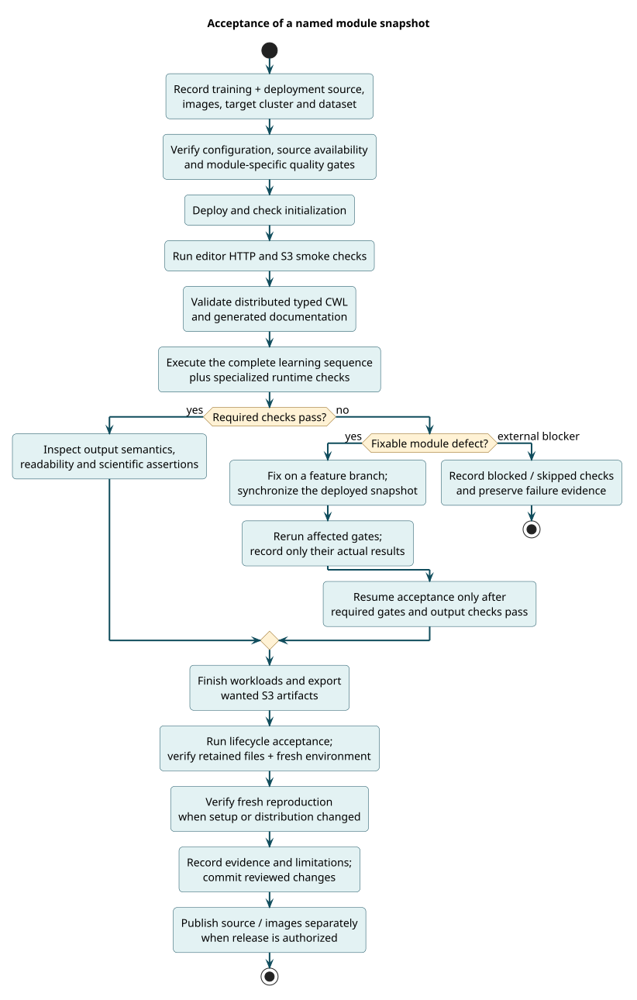

# Validate a module before release

Use this acceptance sequence after changing notebooks, dependencies, CWL, staging code, images, startup or deployment settings. Start from a named source snapshot and identify the actual image and cluster.



[PlantUML source](../diagrams/src/module-acceptance.puml)

## Run the applicable gates

1. **Source and configuration:** inspect feature branches and dirty diffs in both repositories. Parse/render configuration, check shell syntax and confirm referenced source/image artifacts exist. Resolve branch availability before claiming fresh initialization.
2. **Startup:** deploy the module and wait for initialization and editor readiness. Inspect init logs, extensions and the environment used by the kernels. Install success alone does not verify the notebook kernel.
3. **Smoke:** run `task test`. It checks editor HTTP and the module's S3 object round trip. It is an infrastructure check, not full application acceptance.
4. **Contract documentation:** run `task cwl:docs` where implemented. Validate the distributed CWL, embedded types, metadata and generated Markdown. Inspect a representative generated input/output table.
5. **Source quality:** run the source repository's relevant quality and regression tests. Follow its own contribution instructions. Inference supplies `test:code`; contract-first includes quality gates in `labs`.
6. **Learning sequence:** execute all notebooks or workflow cases in dependency order. Use actual application code and containers. Check output semantics and scientific artifacts, not just notebook completion.
7. **Specialized runtime:** Dask additionally needs cluster creation, distributed computation and teardown; inference needs actual model inference; mastering chapter 5 needs the intended published artifacts and a working Kubernetes runner.
8. **Lifecycle:** after active workloads finish, recreate environments and disposable S3 using the supported lifecycle task or explicit script. Verify retained workspace files, compatible new environments and initialized buckets.
9. **Fresh reproduction:** deploy on a fresh workspace/cluster when accepting initialization or release distribution. Preserve existing learner PVCs; use a separate disposable profile for this test. An existing dirty checkout can conceal missing remote branches and missing setup steps.

Example for CWL EOAP, from its deployment directory:

```bash
task deploy KUBE_CONTEXT=<context>
task test KUBE_CONTEXT=<context>
task cwl:docs KUBE_CONTEXT=<context>
task labs KUBE_CONTEXT=<context>
task test:lifecycle KUBE_CONTEXT=<context>
```

Do not run lifecycle checks concurrently with notebooks: they move the environment and restart pods. Repeat affected checks after fixes; a passing result for an older snapshot is not evidence for changed code.

## Record the result

Use a short acceptance note containing:

```text
Module and deployment directory:
Training repository, branch, commit and dirty diff:
Deployment branch and commit:
PDE and application image tags/digests or local image IDs:
CPU architecture, Kubernetes version, context, namespace:
Storage classes and access modes:
Dependencies/lock and active kernel:
Dataset or fixture and authentication path:
Commands, resource budgets and exit results:
Executed notebooks, logs, generated docs and output locations:
Output assertions (catalog links, asset bytes, raster CRS/shape/values):
Lifecycle result and retained environment backup:
Blocked, skipped or untested checks:
```

Keep credential values out of evidence. Record whether data is a local fixture, live remote imagery or a published release artifact. Explain any override, such as a runtime UID fix, so reviewers can reproduce it.

## Decide whether the module is ready

A module is ready for a declared target when its required gates pass against the intended source and artifacts, with reproducible setup and accessible evidence. Distinguish local acceptance from a published release. Publication includes compatible source refs, image availability and appropriate immutable artifact identities.

If an external endpoint fails, record the blocked scientific workflow and successful independent checks separately. The current Dask EOPF limitation is an example. Do not change an acceptance note to “passed” because the cause is external.

For another architecture or cluster, repeat the relevant gates there. The known AMD64 result does not establish ARM64 or multi-node RWX compatibility.
