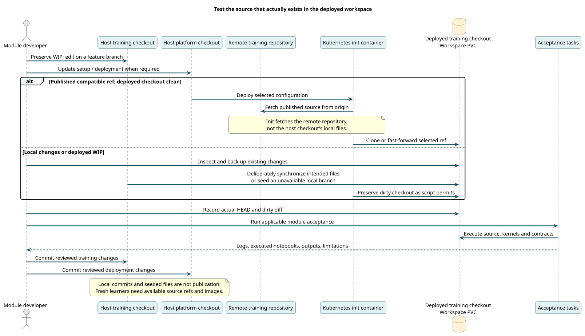

# Select and synchronize training source

Use this guide when an exercise needs a particular release, feature branch or unpublished local change. Deployment configuration and course source are separate checkouts.



[PlantUML source](../diagrams/src/source-to-deployment.puml)

## Establish which source is being tested

The maintained host clones in the development environment are under `/data/work/github-com/eoap`; elsewhere, use your own checkout paths. Inspect both host and deployed state:

```bash
git -C /path/to/stac-eoap branch --show-current
git -C /path/to/stac-eoap rev-parse HEAD
git -C /path/to/stac-eoap status --short
kubectl --context <context> -n eoap-stac exec deployment/code-server-deployment   -c code-server -- git -C /workspace/stac-eoap status --short
```

The deployed PVC is the execution source. A commit on the host, or an updated init ConfigMap, does not automatically replace its files.

## Select a published branch before initialization

The [configuration reference](../reference/configuration.md#training-source-selection) lists the default refs and script variables. Check the remote branch before relying on it:

```bash
git ls-remote --heads https://github.com/eoap/stac-eoap.git feature/typed-cwl-inputs
```

Empty output means that named branch was not found. Use a published compatible ref or seed your local checkout.

The training-ref environment variables are read by **init.sh in the init container**. They are not exposed as generic Taskfile variables. To change one, explicitly set the ref in your module init script, or update the chart to pass that environment variable to the init container. Setting a variable in the host shell alone does not pass it through kubectl or Helm.

Migrated scripts generally preserve dirty checkouts and fast-forward clean ones. Check the particular script: mastering fetches its ref even when preserving edits. A clean local-only branch may therefore still fail to fetch or be switched during initialization.

## Copy changes into a running editor

Stop workload tests first. Inspect and back up existing changes in the deployed checkout. Save a patch or archive outside the checkout before replacing files; neither `git reset --hard` nor deleting a PVC is a synchronization procedure.

Find the current pod:

```bash
kubectl --context <context> -n eoap-stac get pods -l app=code-server
```

Copy only the intended file, retaining its relative location:

```bash
kubectl --context <context> -n eoap-stac cp -c code-server   /path/to/stac-eoap/notebooks/<notebook>.ipynb   <pod-name>:/workspace/stac-eoap/notebooks/<notebook>.ipynb
```

For many files, stream a deliberate archive. Avoid host virtual environments, credentials, build outputs and caches. Include `.git` only when deliberately replacing the checkout's Git history, after preserving deployed work. Reinstall dependencies or recreate the environment if you changed them; copying code is not a dependency update.

## Seed a local branch when initialization cannot clone it

A fresh local-only branch needs a PVC populated before the editor can initialize. A practical recovery procedure is:

1. Let the module deployment create its PVCs and namespace. Its init container may fail on the unavailable ref; that failure is expected until the source exists.
2. Scale `code-server-deployment` to zero and wait for its pods to terminate. This stops init retries and avoids concurrent writes.
3. Create a temporary pod using the same PDE image, mounting **the existing** `code-server-pvc` at `/workspace`, with a writable user/group matching the image (the tested PDE identity is 1001:100; use `fsGroup: 100` if needed).
4. Copy the local training checkout, including `.git`, into `/workspace/<training-repository>`. Exclude host environments, secrets, caches and generated data. Confirm the feature branch and intended diff inside the temporary pod.
5. If the branch cannot be fetched remotely, add a clearly named untracked marker such as `.local-validation-checkout` inside that training checkout. For scripts that skip fetching when dirty, this deliberately preserves the local snapshot. Record the marker as part of acceptance, and confirm the particular init script supports this behavior.
6. Delete the temporary pod, scale the editor back to one and inspect initialization. Use the source's compatible environment and run the full acceptance sequence.

Do not create a second PVC with the same intended role or change Helm ownership to work around the clone failure. Publishing the feature branch is the normal route for other learners to reproduce the environment. Markers are a local validation measure, not a release mechanism.

## Keep branches and evidence separate

Make training changes on a feature branch in its repository and deployment changes on a feature branch here. Preserve WIP. Use Conventional Commits, such as `feat(cwl): add typed scene references` or `fix(labs): assert failed application execution`.

Record the deployed HEAD and diff after copying. Commit and branch publication are distinct: these docs and test tasks do not push commits or release images automatically.
